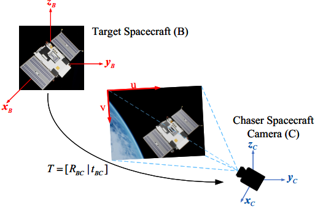
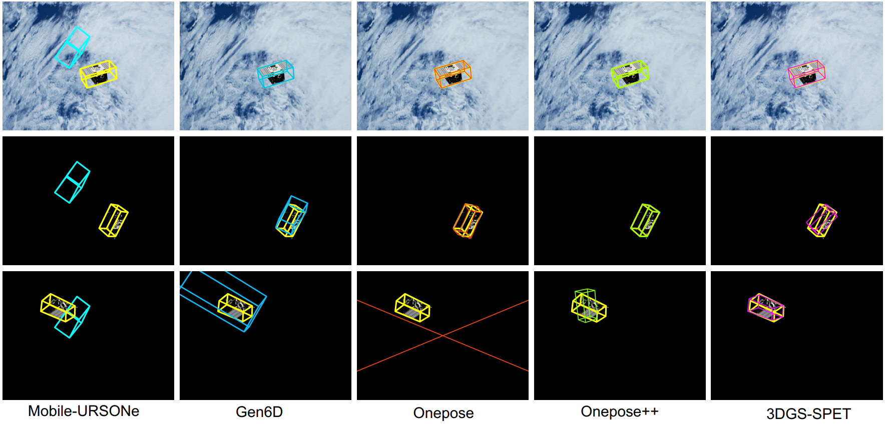

# Incorporating Three-Dimensional Gaussian Splatting for Spacecraft Pose Estimation and Tracking Based on Monocular Visionn




## Abstract 

Accurate spacecraft pose estimation and tracking constitute a critical enabling technology for space exploration missions and on-orbit servicing operations. However, the majority of pose estimation methods exhibit a pronounced dependence on refined depth information or prior three-dimensional (3D) Computer Aided Design (CAD) models; this dependency renders these methods inapplicable to non-cooperative targets. To address this challenge, we propose a novel Spacecraft Pose Estimation and Tracking framework incorporating three-dimensional Gaussian Splatting (3DGS), termed 3DGS-SPET, that aims to implement instance detection, 3D model reconstruction, and 6-Degree-of-Freedom (6-DoF) pose estimation and tracking for non-cooperative targets using only Red-Green-Blue (RGB) images from a monocular vision sensor. The framework has two application modes: single-frame pose estimation and consecutive-frame pose tracking. The single-frame pose estimation pipeline comprises four sequential stages: (i) instance detection of the target spacecraft, (ii) initial pose inference based on semantic features and segmentation masks, (iii) 3D model reconstruction via 3D Gaussian splatting, and (iv) iterative pose optimization through 3D Gaussian rendering. Building upon single-frame pose estimation, consecutive-frame pose tracking associates and jointly optimizes temporally adjacent target poses across image sequences, thereby enhancing target tracking accuracy and stability. We conduct an evaluation using the SPAcecraft Recognition leveraging Knowledge of Space Environment (SPARK) 2024 Challenge dataset. Compared to other state-of-the-art methods, our method achieves more competitive results. 
In summary, this work introduces a novel 3DGS-driven pose estimation paradigm independent of prior CAD models, while providing a precise, monocular vision-only solution for the intelligent perception of space targets. 


## Environment Setup 

cd 3DGS-SPET

conda env create -f environment.yaml

conda activate 3DGS-SPET

bash install_env.sh  

## Download the datasets

### 1) Training Dataset:

- [``MegaPose/gso_1M``](https://www.paris.inria.fr/archive_ylabbeprojectsdata/megapose/webdatasets/) 
- [``MegaPose/google_scanned_objects.zip``](https://www.paris.inria.fr/archive_ylabbeprojectsdata/megapose/tars/) 


### 2) Testing Dataset:
- [SPARK 2024: Datasets for Spacecraft Semantic Segmentation and Spacecraft Trajectory Estimation Dataset](https://https://cvi2.uni.lu/spark-2024-dataset/)


## Data Preparation

Training dataset are organised under the ``dataspace`` directory, as below,

```
dataspace/
├── MegaPose/
│   ├── webdatasets/gso_1M
│   └── google_scanned_objects
...
```

Testing dataset are organised under the ``SPARK2024`` directory, as below,

```
SPARK2024
├── RT509
├── RT519
├── RT529
├── RT539
├── RT549
├── RT559
├── RT569
├── RT579
├── RT589
├── RT599

```

## Evaluation

We utilize the [SPARK2024 spacecraft pose estimation competition dataset](https://https://cvi2.uni.lu/spark-2024-dataset/) for evaluation, and compare our approach with advanced pose estimation methods such as [Mobile-URSONet](https://github.com/possoj/Mobile-URSONet), [Gen6D](https://liuyuan-pal.github.io/Gen6D/) , [OnePose](https://zju3dv.github.io/onepose/), and [OnePose++](https://zju3dv.github.io/onepose_plus_plus/).

The 3DGS-SPET program for pose estimation and tracking is provided in

```
demo/
├── pose-estimation
├── pose-tracking
```

Single-frame pose estimation:
- ``python pose-estimation.py --obj_name RT509 ``

Consecutive-frame pose tracking:
- ``python pose-tracking.py  --obj_name RT509 ``

The SPARK2024 RT509 image sequence used for evaluation can be downloaded from this [link](https://drive.google.com/file/d/1P3rEHJKAlJzL9rm0_OcBG1KFpMBXhcQi/view?usp=drive_link).


## Pose Tracking Visualization

Except for single-frame pose estimation, 3DGS-SPET further extends to pose tracking across consecutive frames.
For relevant visualization results, please download from [here](https://drive.google.com/file/d/1fjRpKm-XvrkuvEF29_QlvCWKStn-nBr4/view?usp=drive_link).



## Training
We utilize a subset (``gso_1M``) of the MegaPose dataset for training.

First, execute the following script under the [``MegaPose``](https://github.com/megapose6d/megapose6d?tab=readme-ov-file) environment for preparing the training data.
- ``python dataset/extract_megapose_to_BOP.py`` 

Then, train the network via
- ``python training/training.py`` 

      
## Acknowledgement
Our work are based on [DINOv2](https://github.com/facebookresearch/dinov2), [3D Gaussian Splatting](https://github.com/graphdeco-inria/gaussian-splatting?tab=readme-ov-file) and [MegaPose](https://github.com/megapose6d/megapose6d), and we use their code. If you use the part of code related to data generation, testing and evaluation, you should cite these paper and follow their license.

##Citation
If you find this project useful, please cite:

@article{ 
  title={Incorporating Three-Dimensional Gaussian Splatting for Monocular Vision Spacecraft Pose Estimation and Tracking},
  
  author={Yuan Li, Dapeng Wu, Chuanfeng Wei, Yaping Cui, Peng He, Yingchen Gu, Yuan Zhang, Ruyan Wang},
  
  journal={IEEE Journal on Miniaturization for Air and Space Systems},
  
  year={2026}
}


